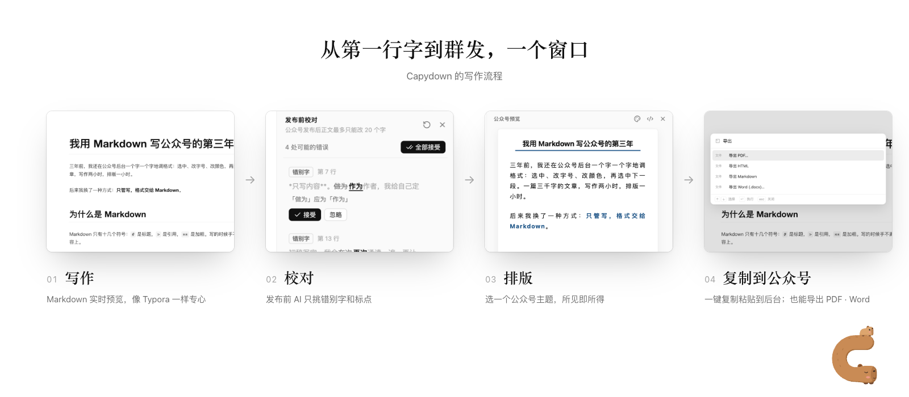
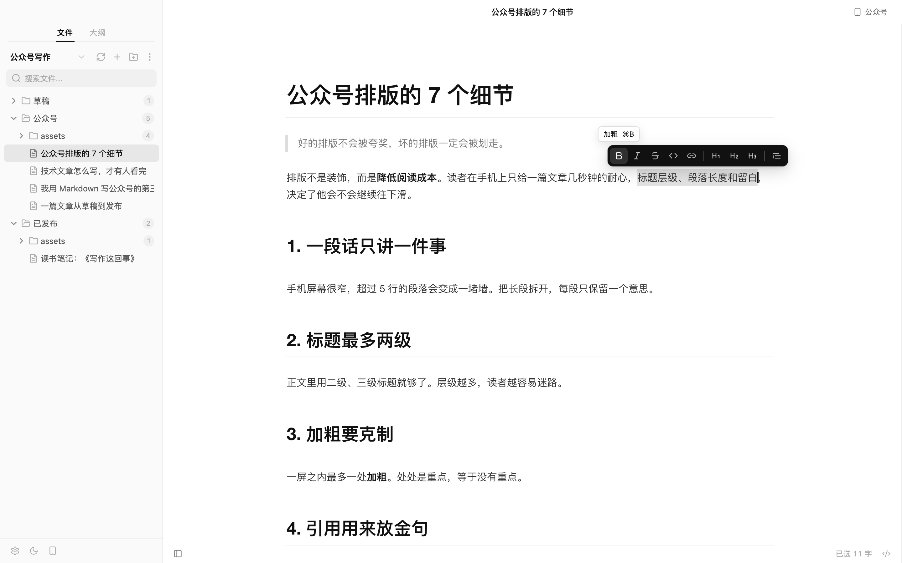
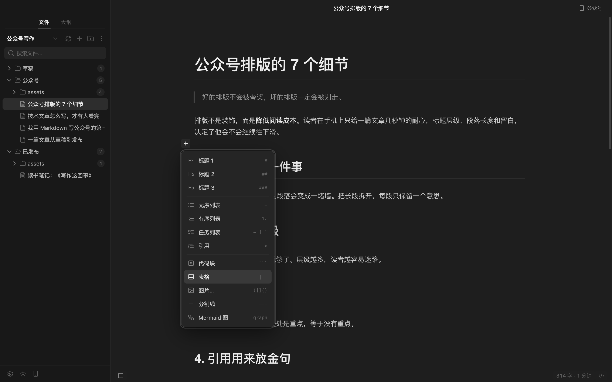
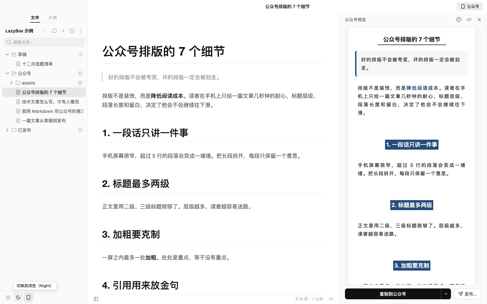
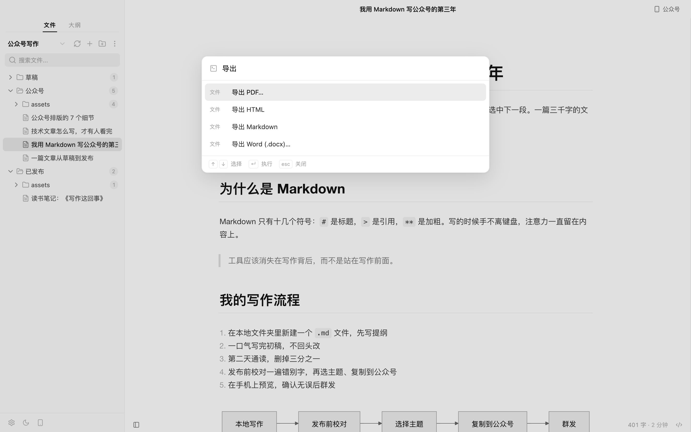
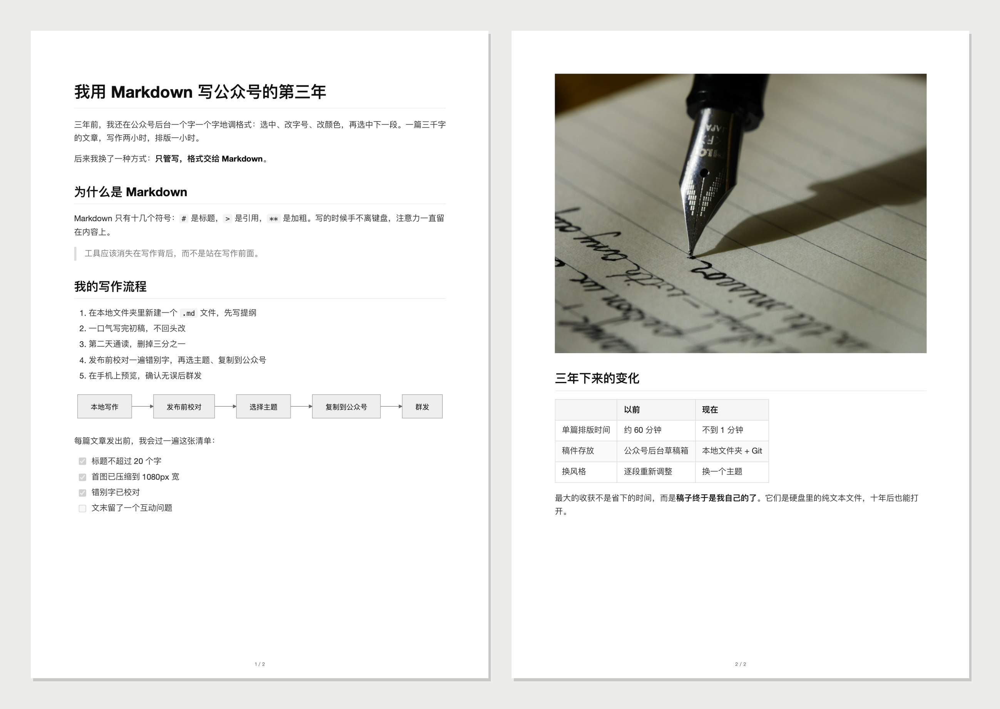
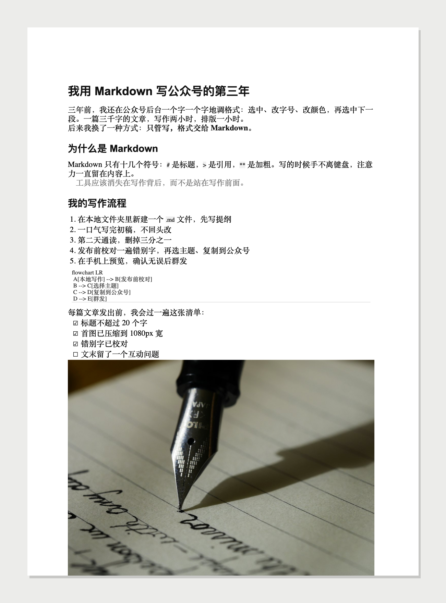

<div align="center">


<p><b>Capydown</b> is a desktop Markdown editor for WeChat Official Account (公众号) writers:<br>write with Typora-like calm, format for 公众号 in one click, and let AI proofread before you publish.</p>

[](https://github.com/melonlee/capydown/actions/workflows/ci.yml)
[](https://github.com/melonlee/capydown/releases)
[](./LICENSE)
[](#download)

[简体中文](./README.md) · **English** · [Website](https://melonlee.github.io/capydown/) · [Download](https://github.com/melonlee/capydown/releases) · [User guide (zh)](./docs/usage.md) · [Changelog](./CHANGELOG.md) · [Roadmap](./docs/ROADMAP.md)

</div>

> [!NOTE]
> **Formerly LazyBox / Slothdown.** Renamed to Capydown in v0.4.0. Existing users just install the new version: on first launch the preferences, AI settings and workspace list of your previous version (Slothdown, or the older LazyBox) are copied over automatically (the old data is left untouched), and your articles stay in your own folders.

**About the name**

- **Capydown** — Capybara + Markdown. Capybaras are famous for staying calm about everything, which is exactly the mood for focused writing.
- Slogan: **Stay calm and write. Capydown does the formatting.** (Chinese: 淡定地写，排版交给卡皮巴拉。)


> The UI is in Chinese, since Capydown is built for writers publishing on WeChat.

## Download

Get the latest build from **[GitHub Releases](https://github.com/melonlee/capydown/releases)**.

| OS | Package | Notes |
| --- | --- | --- |
| macOS (Apple silicon / Intel) | `Capydown-<version>-mac-arm64.dmg` / `-mac-x64.dmg` | Primary development and test platform |
| Windows 10 / 11 | `Capydown-<version>-win-x64-setup.exe` | Built automatically with each release; lightly tested |
| Linux | `Capydown-<version>-linux-<arch>.AppImage` / `.deb` | Built automatically with each release; lightly tested |

> [!IMPORTANT]
> The macOS build is **not signed or notarized** yet. If macOS says the app is "damaged" or from an unidentified developer, move it to Applications and run:
>
> ```bash
> xattr -cr /Applications/Capydown.app
> ```

## Why

公众号 writers want two things: a quiet, Typora-style place to write, and formatting that is done in one click. In practice they write in one app, format in a web tool, and paste into the WeChat backend.

And once an article is published, WeChat lets you change **at most 20 characters** of the body. A typo that ships stays shipped.

So Capydown does three things: writing that feels close to Typora, 公众号 formatting tucked into one panel, and an AI proofread right before you hit publish. The interface is strictly black and white — colour is left to your article.



## Writing


- **Live preview** on CodeMirror 6: Markdown renders as you type; markers like `#` and `**` appear only where the cursor is
- **Byte-exact files**: open, don't edit, close, and the file is unchanged — line endings, indentation and table alignment are never reformatted
- **Source mode** `⌘/`, **Files / Outline sidebar** `⇧⌘L`, **Focus mode** `F8`, **Typewriter mode** `F9`
- **Quick open** `⌘P` and a **command palette** `⇧⌘P` covering every menu command
- **Editor themes**: GitHub, Newsprint and Night, optionally following the system dark mode
- **Images**: pasted or dropped images are saved to an `assets/` folder next to the document with a relative path; if an image host is configured they are uploaded instead

<table>
  <tr>
    <td width="50%"><p align="center"><sub>Focus mode</sub></p></td>
    <td width="50%"><p align="center"><sub>Quick open</sub></p></td>
  </tr>
  <tr>
    <td><p align="center"><sub>Newsprint</sub></p></td>
    <td><p align="center"><sub>Night</sub></p></td>
  </tr>
</table>

### Formatting where you write <sup>v0.3.0</sup>

No permanent toolbar, but the common actions are at hand. They all run the same commands as the menus, and all can be undone.

- **Floating toolbar on selection**: bold, italic, strikethrough, inline code, link, headings 1–3, quote; hover for the shortcut
- **"+" on empty lines**: insert a heading, list, quote, code block, table, image, divider or Mermaid diagram; arrow keys + Enter work
- **Native right-click menu**: cut / copy / paste, paragraph, format, insert, proofread; open or copy links
- **Sidebar bottom-left**: settings, light / dark toggle, 公众号 preview

<table>
  <tr>
    <td width="50%"><p align="center"><sub>Select text, the toolbar appears</sub></p></td>
    <td width="50%"><p align="center"><sub>The "+" insert menu on an empty line</sub></p></td>
  </tr>
  <tr>
    <td><p align="center"><sub>Settings, light / dark and 公众号 preview</sub></p></td>
    <td><p align="center"><sub>Export: PDF, Word, Markdown, HTML</sub></p></td>
  </tr>
</table>

## 公众号 formatting


- `⌥⌘P` opens a side panel that renders the article exactly as 公众号 will show it
- Three article themes with adjustable font, size, accent colour and code style, plus custom CSS
- **Copy to 公众号** (`⇧⌘C`) puts inline-styled HTML on the clipboard — paste it straight into the WeChat editor
- Local images are flagged before copying, since they must be re-uploaded in the WeChat backend (or configure an image host)

## Export to PDF / Word <sup>v0.3.0</sup>

- **PDF** follows the editor theme (GitHub / Newsprint; Night exports light): A4 with page numbers, code highlighting, tables, task lists, local images and Mermaid; headings never sit at a page bottom, code blocks and images don't split across pages
- **Word (.docx)** keeps heading styles, bold / italic / strikethrough / inline code, links, nested lists, quotes, code blocks and tables, and embeds images scaled to the page width
- Saved next to the article with the same name by default; Markdown (with front matter) and HTML export are also available

<table>
  <tr>
    <td width="58%"></td>
    <td width="42%"></td>
  </tr>
</table>

## Open with Capydown <sup>v0.3.0</sup>

After installing, Capydown registers as an "Open With" handler for `.md`, `.markdown` and friends without taking over the default app: right-click a file → Open With → Capydown (Windows: "Open with → Choose another app"; Linux registers `text/markdown`). A file inside the current workspace opens directly; otherwise its folder opens as the workspace. If the app is already running, the existing window takes it. Opening never modifies the file.

## Two AI helpers

AI does exactly two things, both right before publishing. It is off until you bring your own API key (BYOK).

<table>
  <tr>
    <td width="50%"></td>
    <td width="50%"></td>
  </tr>
  <tr>
    <td valign="top"><b>Pre-publish proofreading</b><br><sub>Typos, grammar, punctuation and repeated words. Jump to, accept or ignore each issue, or accept all — a single <code>⌘Z</code> undoes it. Code, links and front matter are never touched. CJK/Latin spacing is an opt-in style suggestion.</sub></td>
    <td valign="top"><b>Titles + summary</b><br><sub>In the publish dialog: 3–5 title candidates (≤ 64 characters each) and a summary of ≤ 120 characters, matching WeChat's limits.</sub></td>
  </tr>
</table>

### Setting up AI

**Preferences → AI** (`⌘,`):

1. **Provider**: Claude (Anthropic) or "OpenAI-compatible" — DeepSeek, Kimi, Qwen, OpenAI or any `chat/completions` gateway
2. **Base URL** (OpenAI-compatible): usually ends in `/v1`, e.g. `https://api.deepseek.com/v1`; presets fill it in for common providers
3. **API key** and **model**, e.g. `deepseek-chat`, `qwen-plus`, `claude-sonnet-4-6`
4. Click **Test connection**, then save

> **Privacy**: article text is sent to your provider only when you start a proofread or ask for titles. Capydown has no server of its own and never sees your text or key.

## Local first

- Articles are plain `.md` files on your disk; any folder can be a workspace. No account, no cloud sync
- Images live in `assets/` beside the document, so the folder works in Git, cloud drives, Typora or Obsidian
- AI requests go straight from your computer to the provider you chose; keys are stored only in the local app config
- No analytics or tracking

## Shortcuts

`⌘` is `Ctrl` and `⌥` is `Alt` on Windows / Linux. Full list in the [user guide](./docs/usage.md#快捷键).

| Action | Shortcut | Action | Shortcut |
| --- | --- | --- | --- |
| Quick open | `⌘P` | Command palette | `⇧⌘P` |
| Source mode | `⌘/` | Sidebar | `⇧⌘L` |
| Outline / Files | `⌃⌘1` / `⌃⌘3` | 公众号 preview | `⌥⌘P` |
| Focus mode | `F8` | Typewriter mode | `F9` |
| Heading 1–6 / Paragraph | `⌘1`–`⌘6` / `⌘0` | Bold / Italic | `⌘B` / `⌘I` |
| Inline code | `⌘E` | Link | `⌥⌘K` |
| Copy to 公众号 | `⇧⌘C` | Preferences | `⌘,` |

## Known gaps

Capydown is Typora-style, not Typora:

- Tables are edited as Markdown source when the cursor enters them
- Math and HTML blocks are shown as source, not rendered
- Pasting rich text from the web inserts plain text
- The 公众号 preview follows the editor's scroll, not the other way round
- Publishing is via clipboard; saving straight to the 公众号 draft box is not implemented yet
- Builds are unsigned; Windows / Linux are lightly tested

## FAQ

**I use Slothdown or LazyBox — what do I need to do?** Nothing. Both are Capydown's old names. On first launch the new version copies the preferences, AI settings and workspace list of your most recent old version (Slothdown first, otherwise LazyBox) into its new profile (the old one is kept). Your articles live in your own folders and are unaffected, and the default workspace keeps its old folder. Once everything looks right you can delete the old `Slothdown.app` / `LazyBox.app`.

**Is this affiliated with Typora?** No. Capydown is an independent open-source project that uses Typora as its reference for the writing experience.

**Images disappear after pasting into WeChat?** WeChat cannot read files on your computer. Re-upload them in the backend, or configure an image host (GitHub, Aliyun OSS, Tencent COS, Qiniu, MinIO, Cloudflare R2 …) so new images are uploaded on paste.

**Do I need AI?** No. Writing, formatting, copying and PDF / Word export work without it.

**How is it different from doocs/md?** The 公众号 formatting comes from [doocs/md](https://github.com/doocs/md). Capydown wraps it in a local-first desktop editor with live preview, workspaces, pre-publish proofreading and PDF / Word export.

## Roadmap

Next up: visual table editing, saving to the 公众号 draft box (AppID / AppSecret), math rendering, paste-from-web as Markdown, macOS signing and notarization, Windows / Linux QA. See [docs/ROADMAP.md](./docs/ROADMAP.md).

## Development

Requires Node.js 20+ and pnpm.

```bash
pnpm install
pnpm dev          # dev mode with hot reload
pnpm build        # production build
pnpm test         # unit tests (Vitest)
pnpm build:mac    # package; also build:win / build:linux
```

Stack: Electron · Vue 3 · electron-vite · TypeScript · CodeMirror 6 · Pinia · Tailwind / UnoCSS. See [CLAUDE.md](./CLAUDE.md) and [docs/dev/](./docs/dev/); brand assets and their generators live in [docs/assets/brand/](./docs/assets/brand/). Website: <https://melonlee.github.io/capydown/> (source in [`website/`](./website/), auto-deployed to GitHub Pages).

## Contributing

Issues and pull requests are welcome. Please run `pnpm test` and `pnpm build` before submitting, and open an issue first for larger roadmap items.

## Acknowledgements

- [doocs/md](https://github.com/doocs/md) — Markdown rendering and 公众号 formatting; Capydown is a fork
- [electron-vite](https://github.com/alex8088/electron-vite)
- [CodeMirror](https://codemirror.net/)
- Sample photos in screenshots from [Unsplash](https://unsplash.com/)

## License

[MIT](./LICENSE), retaining the original copyright notice.

## Star History

<a href="https://www.star-history.com/#melonlee/capydown&Date">
 <picture>
   <source media="(prefers-color-scheme: dark)" srcset="https://api.star-history.com/svg?repos=melonlee/capydown&type=Date&theme=dark" />
   <source media="(prefers-color-scheme: light)" srcset="https://api.star-history.com/svg?repos=melonlee/capydown&type=Date" />
   
 </picture>
</a>

<br><br>

<div align="center">
  
  <br>
  <sub>The icon is a capybara from the same mascot family as 喵想 · FantasyAI Lab, peeking up from the bottom edge with a baby capybara lying on its head</sub>
  <br>
  <sub>Capydown · Made by <a href="https://github.com/melonlee">Melon</a> · <a href="https://fantasyailab.com/">FantasyAI Lab</a></sub>
</div>
