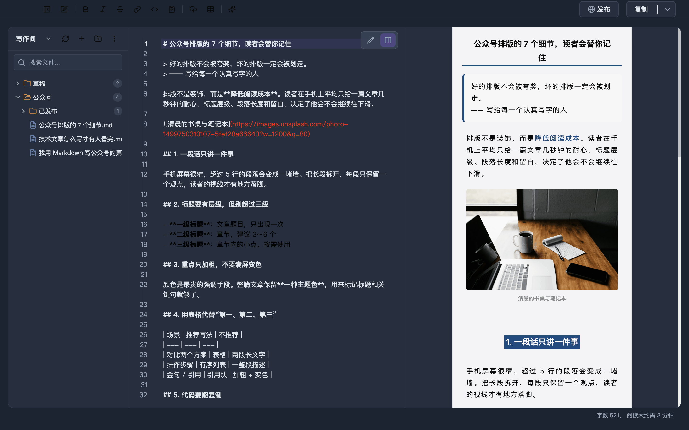
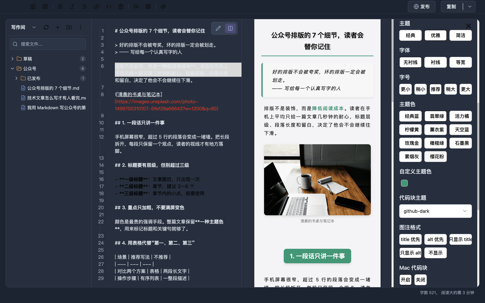
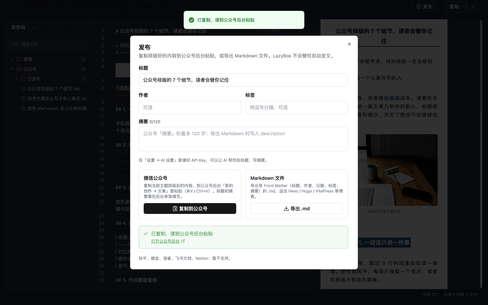
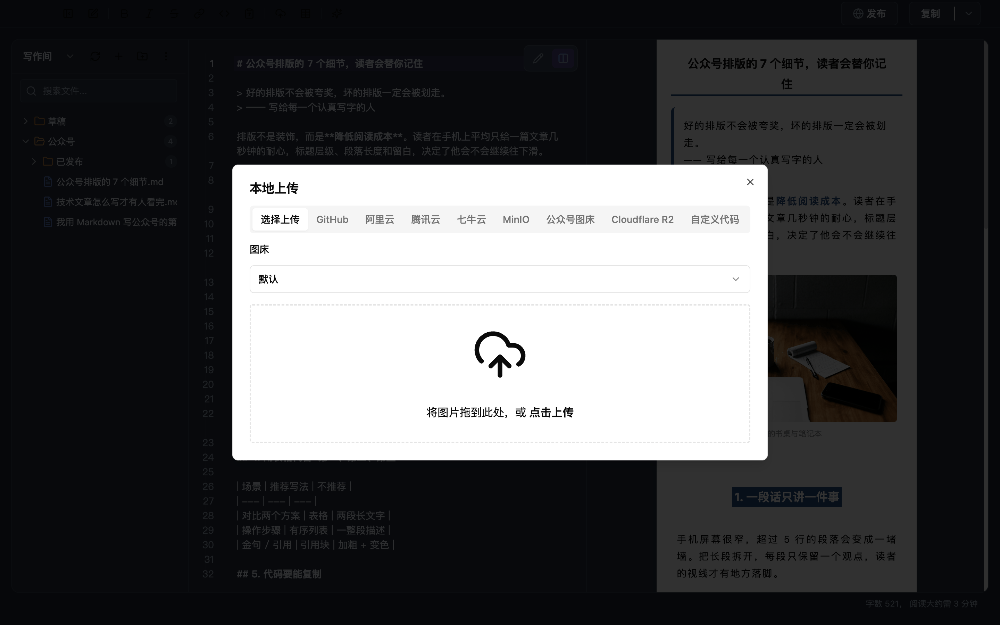
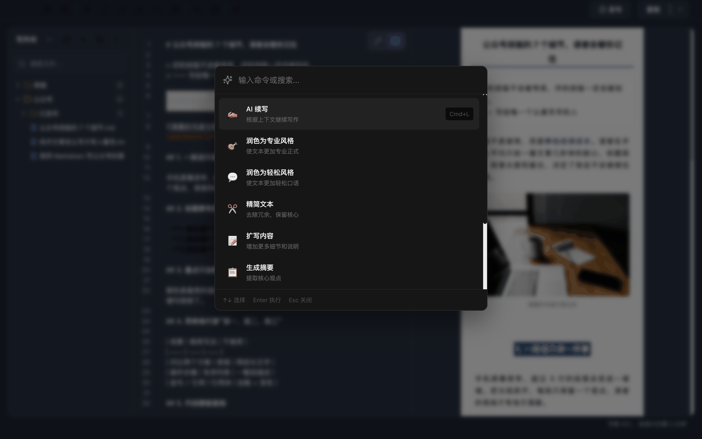
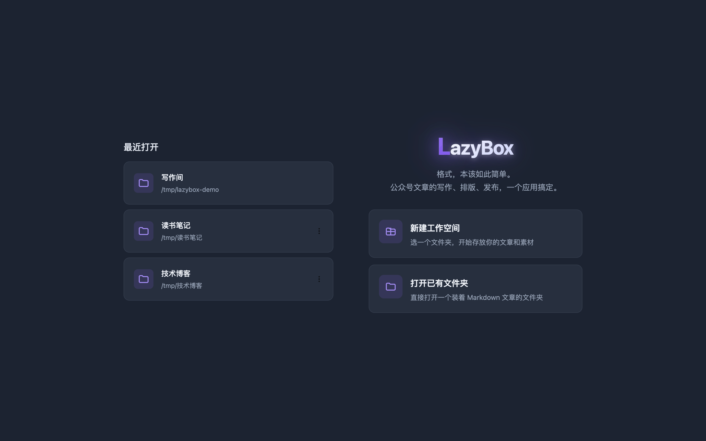

<div align="center">


<h3>A desktop Markdown editor for WeChat Official Account writers</h3>

<p>Write locally · switch themes in one click · upload images to your image host · paste straight into the WeChat editor</p>

[](https://github.com/melonlee/LazyBox/releases)
[](https://github.com/melonlee/LazyBox/actions/workflows/ci.yml)
[](https://github.com/melonlee/LazyBox/releases)
[](https://github.com/melonlee/LazyBox/stargazers)
[](./LICENSE)

[简体中文](./README.md) · **English** · [Download](https://github.com/melonlee/LazyBox/releases) · [User guide (Chinese)](./docs/usage.md) · [Changelog](./CHANGELOG.md) · [Roadmap](./docs/ROADMAP.md)

</div>

---

## Why LazyBox

Writing long posts in the WeChat Official Account (公众号) web editor means spending a lot of time on formatting — select, change size, change colour, repeat for the next paragraph. Changing the look means doing it all again, and your drafts live in a web back office that is hard to back up or reuse.

LazyBox separates the two: **you write plain Markdown, a theme does the formatting.** Every article is a `.md` file on your disk. When you are done, copy it and paste it into the WeChat editor — styles included.

<div align="center">
  
</div>

## Screenshots

<table>
  <tr>
    <td width="50%"><p align="center"><b>Split view</b>: Markdown on the left, the WeChat rendering on the right</p></td>
    <td width="50%"><p align="center"><b>Themes</b>: layout theme, font, accent colour, code style</p></td>
  </tr>
  <tr>
    <td><p align="center"><b>Publish</b>: copy for WeChat, or export Markdown with front matter</p></td>
    <td><p align="center"><b>Image upload</b>: GitHub, Aliyun OSS, Tencent COS, Qiniu…</p></td>
  </tr>
  <tr>
    <td><p align="center"><b>Optional AI</b>: ⌘K to polish, expand, continue, translate</p></td>
    <td><p align="center"><b>Workspaces</b>: any folder is an article library</p></td>
  </tr>
</table>

<sub>Real screenshots of the app; the articles are demo content. The UI is in Chinese.</sub>

## Features

**✍️ Write**
- Open any folder as a workspace; tree view with create, rename, drag-to-move and search
- Edit-only and split views, autosave
- Formatting toolbar and shortcuts; tables, syntax-highlighted code, Mermaid diagrams

**🎨 Format**
- Live preview of how the post will look in WeChat
- Three layout themes; adjustable font, size, accent colour, code theme and captions
- Custom CSS on top of any theme

**🖼️ Images**
- Drag-and-drop upload to GitHub, Aliyun OSS, Tencent COS, Qiniu, MinIO, Cloudflare R2, the WeChat image host, or your own upload script

**🚀 Publish**
- Copy as WeChat-ready HTML (inline styles) and paste into the WeChat editor
- Warns about local / base64 images that WeChat cannot fetch
- Export Markdown with front matter (Hexo / Hugo / VitePress) or HTML

**🤖 AI (optional, bring your own key)**
- Claude, plus any OpenAI-compatible API: DeepSeek, Kimi, Qwen, OpenAI…
- Title suggestions, a ≤120-character WeChat summary, polish, expand, continue, translate
- Requests go straight from your machine to the provider you choose

> One-click publishing to Zhihu, Juejin, Yuque, Feishu and Notion is **not supported yet**. Prototype modules (MCP, knowledge base, AI image generation) are off by default — see the [roadmap](./docs/ROADMAP.md).

## Download

Get the latest build from the **[Releases page](https://github.com/melonlee/LazyBox/releases)**.

| OS | Package |
| --- | --- |
| macOS (Apple silicon / Intel) | `.dmg` |
| Windows | `-setup.exe` |
| Linux | `.AppImage` / `.deb` |

> Builds are not code-signed yet. On macOS, if the app is reported as "damaged", run `xattr -cr /Applications/LazyBox.app`; otherwise right-click → Open.

## Getting started

1. Launch LazyBox and **create a workspace** or **open an existing folder**
2. Create an article, write in split view, press ⌘, to pick a theme
3. Click **发布 (Publish) → 复制到公众号 (Copy to WeChat)** and paste into the [WeChat editor](https://mp.weixin.qq.com/)

## Development

Requires Node.js 20+ and pnpm.

```bash
git clone https://github.com/melonlee/LazyBox.git
cd LazyBox
pnpm install
pnpm dev          # development mode
pnpm test         # unit tests
pnpm build        # build into out/
pnpm build:mac    # package an installer (also build:win / build:linux)
```

Stack: Electron 28 · Vue 3 · Vite (electron-vite) · TypeScript · CodeMirror 5 · Pinia · Tailwind / UnoCSS.

To release: bump `package.json` and `CHANGELOG.md`, push a `v*` tag; GitHub Actions builds macOS, Windows and Linux packages and drafts a release.

## Contributing

Issues and pull requests are welcome. Please run `pnpm test` and `pnpm build` before submitting.

## Acknowledgements

- [doocs/md](https://github.com/doocs/md) — Markdown rendering and WeChat formatting
- [electron-vite](https://github.com/alex8088/electron-vite)
- Photos in the screenshots are from [Unsplash](https://unsplash.com/)

## License

[MIT](./LICENSE)
