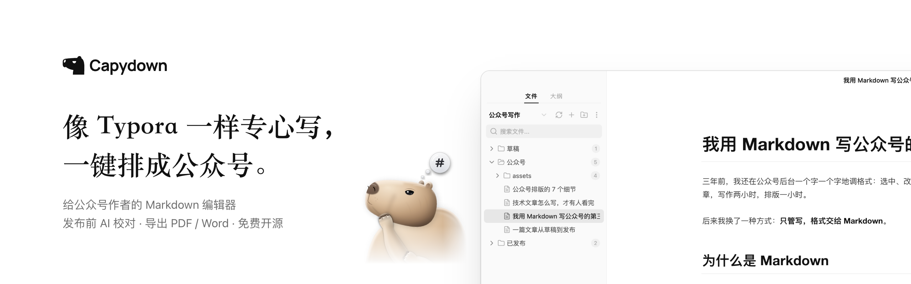
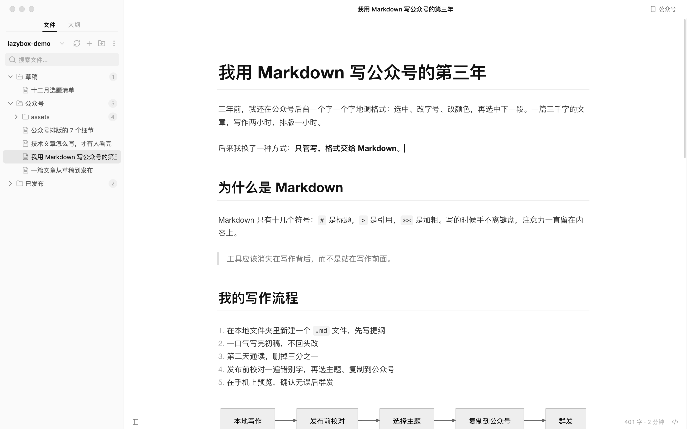
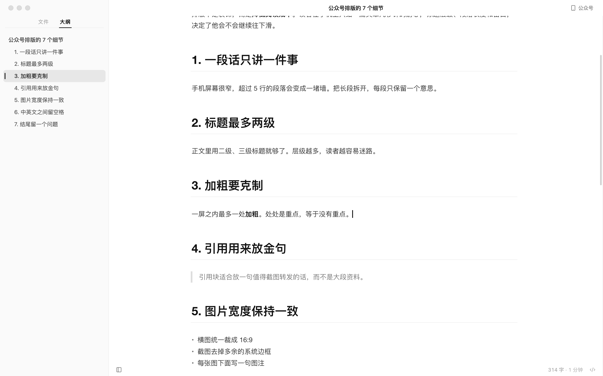
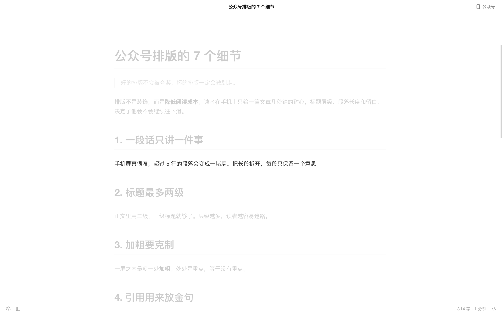
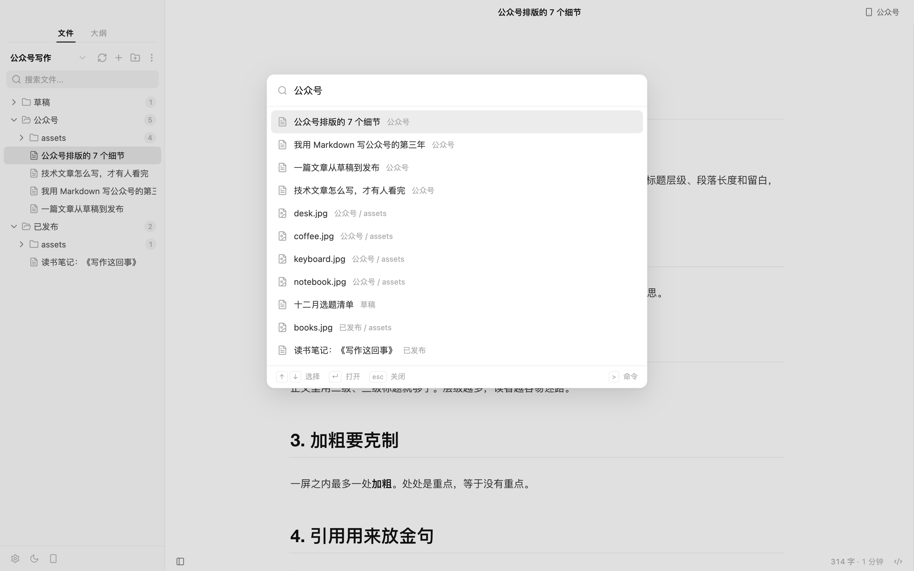
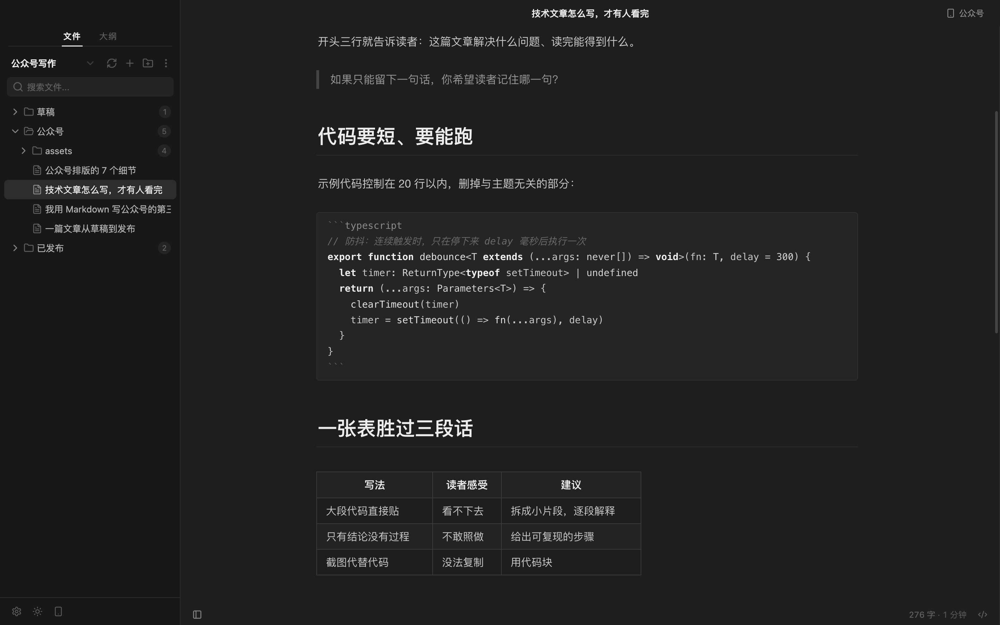
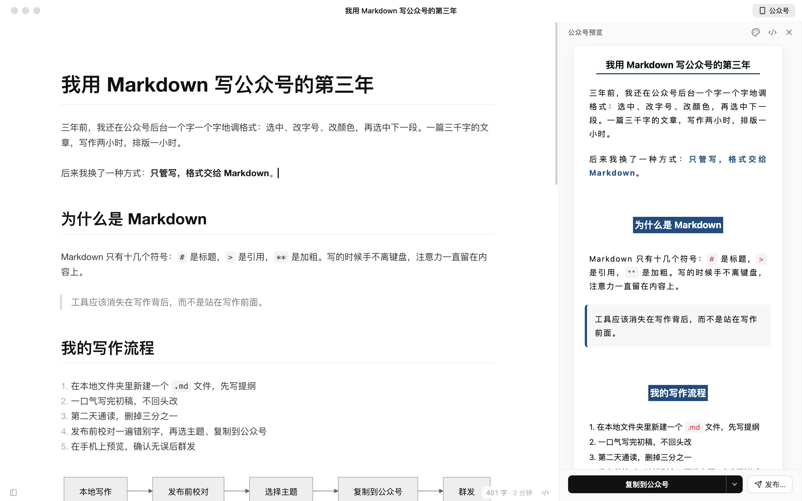
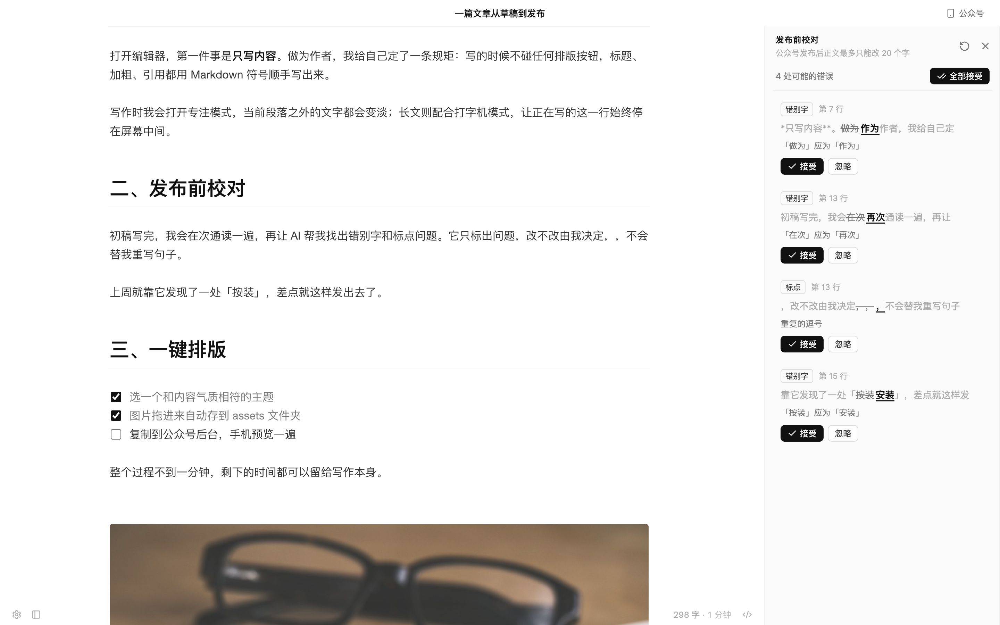
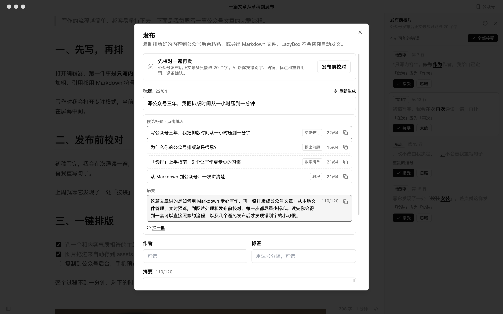

<div align="center">



<p><b>LazyBox</b> is a desktop Markdown editor for WeChat Official Account (公众号) writers:<br>write with Typora-like calm, format for 公众号 in one click, and let AI proofread before you publish.</p>

[](https://github.com/melonlee/LazyBox/actions/workflows/ci.yml)
[](https://github.com/melonlee/LazyBox/releases)
[](./LICENSE)
[](#download)

[简体中文](./README.md) · **English** · [Download](https://github.com/melonlee/LazyBox/releases) · [User guide (zh)](./docs/usage.md) · [Changelog](./CHANGELOG.md) · [Roadmap](./docs/ROADMAP.md)

</div>

<br>



> The UI is in Chinese, since LazyBox is built for writers publishing on WeChat.

## Download

Get the latest build from **[GitHub Releases](https://github.com/melonlee/LazyBox/releases)**.

| OS | Package | Notes |
| --- | --- | --- |
| macOS (Apple silicon / Intel) | `.dmg` | Primary development and test platform |
| Windows 10 / 11 | `-setup.exe` | Built automatically from v0.2.0 on; lightly tested |
| Linux | `.AppImage` / `.deb` | Built automatically from v0.2.0 on; lightly tested |

> [!NOTE]
> The macOS build is **not signed or notarized** yet. If macOS says the app is "damaged" or from an unidentified developer, move it to Applications and run:
>
> ```bash
> xattr -cr /Applications/LazyBox.app
> ```

## Why

公众号 writers want two things: a quiet, Typora-style place to write, and formatting that is done in one click. In practice they write in one app, format in a web tool, and paste into the WeChat backend.

And once an article is published, WeChat lets you change **at most 20 characters** of the body. A typo that ships stays shipped.

So LazyBox does three things: writing that feels close to Typora, 公众号 formatting tucked into one panel, and an AI proofread right before you hit publish.

## Writing



- **Live preview** on CodeMirror 6: Markdown renders as you type; markers like `#` and `**` appear only where the cursor is
- **Byte-exact files**: open, don't edit, close, and the file is unchanged — line endings, indentation and table alignment are never reformatted
- **Source mode** `⌘/`, **Files / Outline sidebar** `⇧⌘L`, **Focus mode** `F8`, **Typewriter mode** `F9`
- **Quick open** `⌘P` and a **command palette** `⇧⌘P` covering every menu command
- **Editor themes**: GitHub, Newsprint and Night, optionally following the system dark mode
- **Images**: pasted or dropped images are saved to an `assets/` folder next to the document with a relative path; if an image host is configured they are uploaded instead

<table>
  <tr>
    <td width="50%"><p align="center"><sub>Focus mode</sub></p></td>
    <td width="50%"><p align="center"><sub>Quick open</sub></p></td>
  </tr>
  <tr>
    <td><p align="center"><sub>Newsprint</sub></p></td>
    <td><p align="center"><sub>Night</sub></p></td>
  </tr>
</table>

## 公众号 formatting



- `⌥⌘P` opens a side panel that renders the article exactly as 公众号 will show it
- Three article themes with adjustable font, size, accent colour and code style, plus custom CSS
- **Copy to 公众号** (`⇧⌘C`) puts inline-styled HTML on the clipboard — paste it straight into the WeChat editor
- Local images are flagged before copying, since they must be re-uploaded in the WeChat backend (or configure an image host)
- Export Markdown with front matter, or HTML

## Two AI helpers

AI does exactly two things, both right before publishing. It is off until you bring your own API key.

<table>
  <tr>
    <td width="50%"></td>
    <td width="50%"></td>
  </tr>
  <tr>
    <td valign="top"><b>Pre-publish proofreading</b><br><sub>Typos, grammar, punctuation and repeated words. Jump to, accept or ignore each issue, or accept all — a single <code>⌘Z</code> undoes it. Code, links and front matter are never touched. CJK/Latin spacing is an opt-in style suggestion.</sub></td>
    <td valign="top"><b>Titles + summary</b><br><sub>In the publish dialog: 3–5 title candidates (≤ 64 characters each) and a summary of ≤ 120 characters, matching WeChat's limits.</sub></td>
  </tr>
</table>

## Local first

- Articles are plain `.md` files on your disk; any folder can be a workspace. No account, no cloud sync
- Images live in `assets/` beside the document, so the folder works in Git, cloud drives, Typora or Obsidian
- AI requests go straight from your computer to the provider you chose; keys are stored only in the local app config
- No analytics or tracking

## Shortcuts

`⌘` is `Ctrl` and `⌥` is `Alt` on Windows / Linux. Full list in the [user guide](./docs/usage.md#快捷键).

| Action | Shortcut | Action | Shortcut |
| --- | --- | --- | --- |
| Quick open | `⌘P` | Command palette | `⇧⌘P` |
| Source mode | `⌘/` | Sidebar | `⇧⌘L` |
| Outline / Files | `⌃⌘1` / `⌃⌘3` | 公众号 preview | `⌥⌘P` |
| Focus mode | `F8` | Typewriter mode | `F9` |
| Heading 1–6 / Paragraph | `⌘1`–`⌘6` / `⌘0` | Bold / Italic | `⌘B` / `⌘I` |
| Inline code | `⌘E` | Link | `⌥⌘K` |
| Copy to 公众号 | `⇧⌘C` | Preferences | `⌘,` |

## Setting up AI

**Preferences → AI** (`⌘,`):

1. **Provider**: Claude (Anthropic) or "OpenAI-compatible" — DeepSeek, Kimi, Qwen, OpenAI or any `chat/completions` gateway
2. **Base URL** (OpenAI-compatible): usually ends in `/v1`, e.g. `https://api.deepseek.com/v1`; presets fill it in for common providers
3. **API key** and **model**, e.g. `deepseek-chat`, `qwen-plus`, `claude-sonnet-4-6`
4. Click **Test connection**, then save

> **Privacy**: article text is sent to your provider only when you start a proofread or ask for titles. LazyBox has no server of its own and never sees your text or key.

## Known gaps

LazyBox is Typora-style, not Typora:

- Tables are edited as Markdown source when the cursor enters them
- Math and HTML blocks are shown as source, not rendered
- Pasting rich text from the web inserts plain text
- The 公众号 preview follows the editor's scroll, not the other way round
- Publishing is via clipboard; saving straight to the 公众号 draft box is not implemented yet

## FAQ

**Is this affiliated with Typora?** No. LazyBox is an independent open-source project that uses Typora as its reference for the writing experience.

**Images disappear after pasting into WeChat?** WeChat cannot read files on your computer. Re-upload them in the backend, or configure an image host (GitHub, Aliyun OSS, Tencent COS, Qiniu, MinIO, Cloudflare R2 …) so new images are uploaded on paste.

**Do I need AI?** No. Writing, formatting and copying work without it.

**How is it different from doocs/md?** The 公众号 formatting comes from [doocs/md](https://github.com/doocs/md). LazyBox wraps it in a local-first desktop editor with live preview, workspaces and pre-publish proofreading.

## Roadmap

Next up: visual table editing, math rendering, saving to the 公众号 draft box (AppID / AppSecret), macOS signing and notarization, Windows / Linux QA. See [docs/ROADMAP.md](./docs/ROADMAP.md).

## Development

Requires Node.js 20+ and pnpm.

```bash
pnpm install
pnpm dev          # dev mode with hot reload
pnpm build        # production build
pnpm test         # unit tests (Vitest)
pnpm build:mac    # package; also build:win / build:linux
```

Stack: Electron · Vue 3 · electron-vite · TypeScript · CodeMirror 6 · Pinia · Tailwind / UnoCSS. See [CLAUDE.md](./CLAUDE.md) and [docs/dev/](./docs/dev/). The website is a build-free static page in [`website/`](./website/).

## Contributing

Issues and pull requests are welcome. Please run `pnpm test` and `pnpm build` before submitting, and open an issue first for larger roadmap items.

## Acknowledgements

- [doocs/md](https://github.com/doocs/md) — Markdown rendering and 公众号 formatting; LazyBox is a fork
- [electron-vite](https://github.com/alex8088/electron-vite)
- [CodeMirror](https://codemirror.net/)
- Sample photos in screenshots from [Unsplash](https://unsplash.com/)

## License

[MIT](./LICENSE), retaining the original copyright notice.

## Star History

<a href="https://www.star-history.com/#melonlee/LazyBox&Date">
 <picture>
   <source media="(prefers-color-scheme: dark)" srcset="https://api.star-history.com/svg?repos=melonlee/LazyBox&type=Date&theme=dark" />
   <source media="(prefers-color-scheme: light)" srcset="https://api.star-history.com/svg?repos=melonlee/LazyBox&type=Date" />
   
 </picture>
</a>

<br><br>

<div align="center">
  
  <br>
  <sub>Made by <a href="https://github.com/melonlee">Melon</a> · <a href="https://fantasyailab.com/">FantasyAI Lab</a></sub>
</div>
