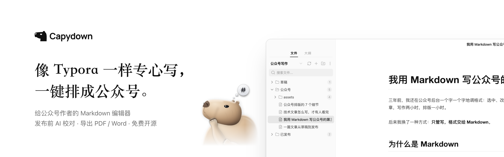
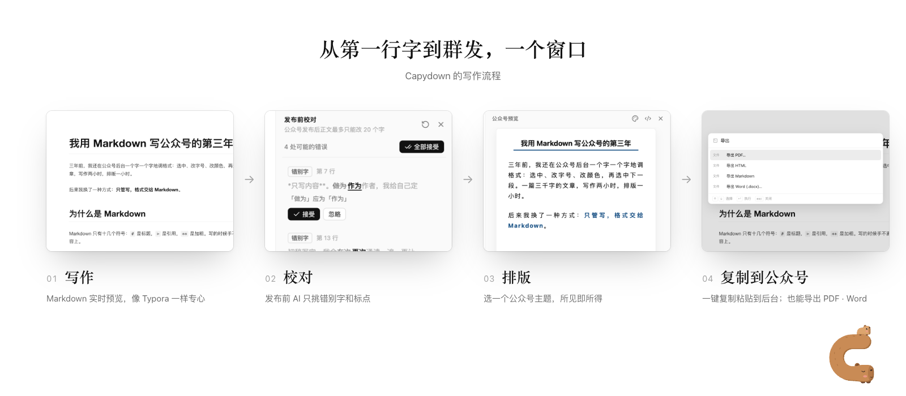
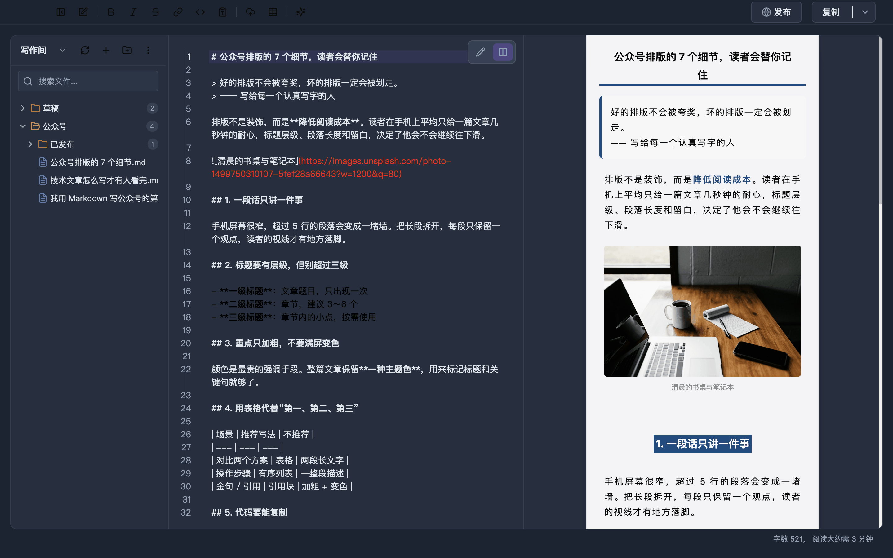
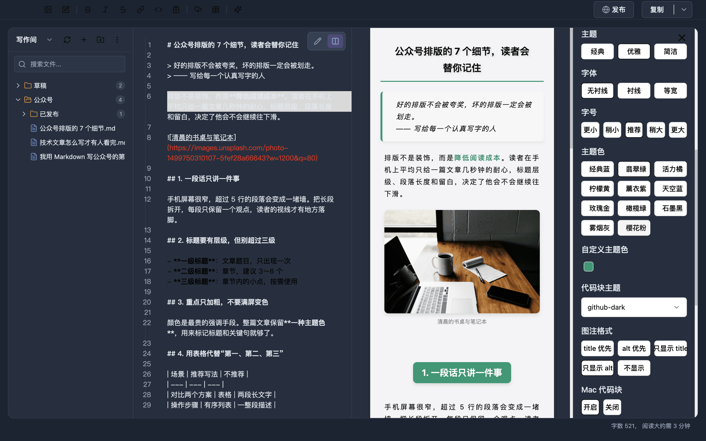
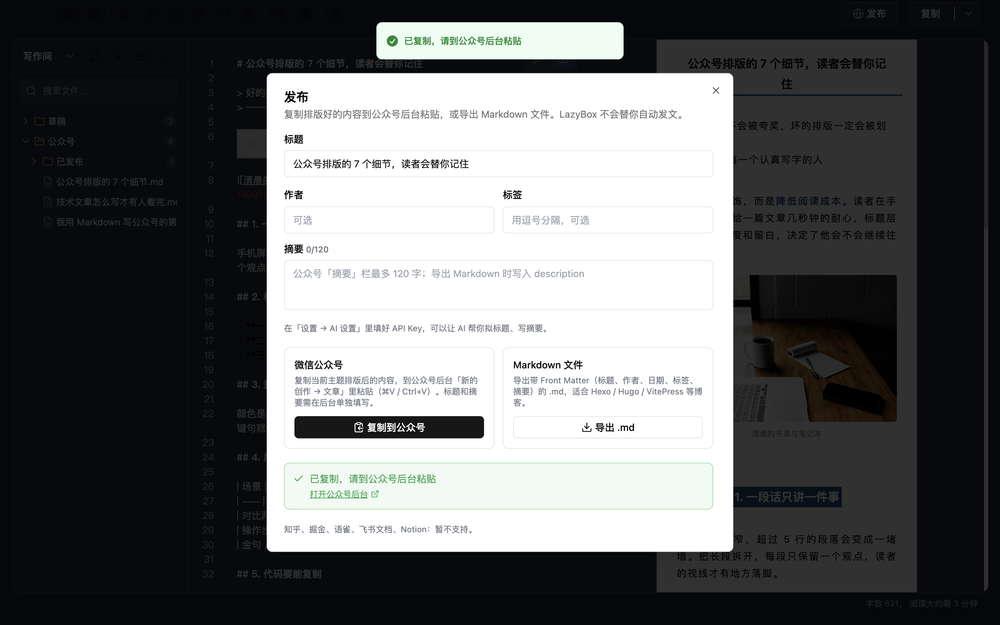
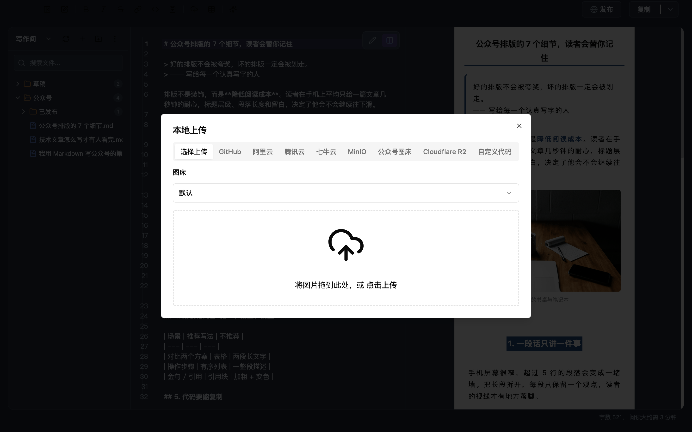
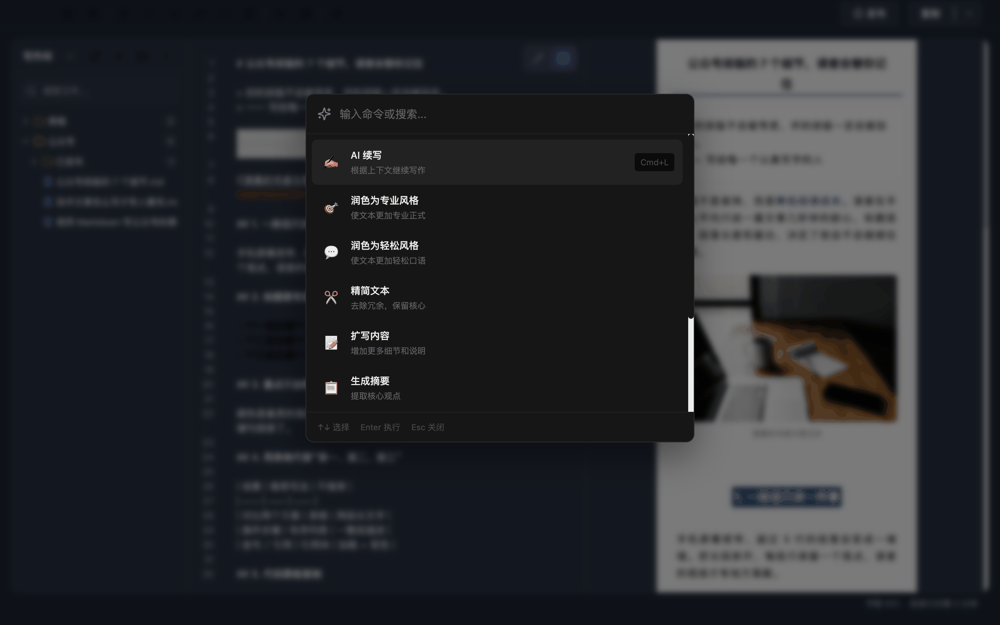
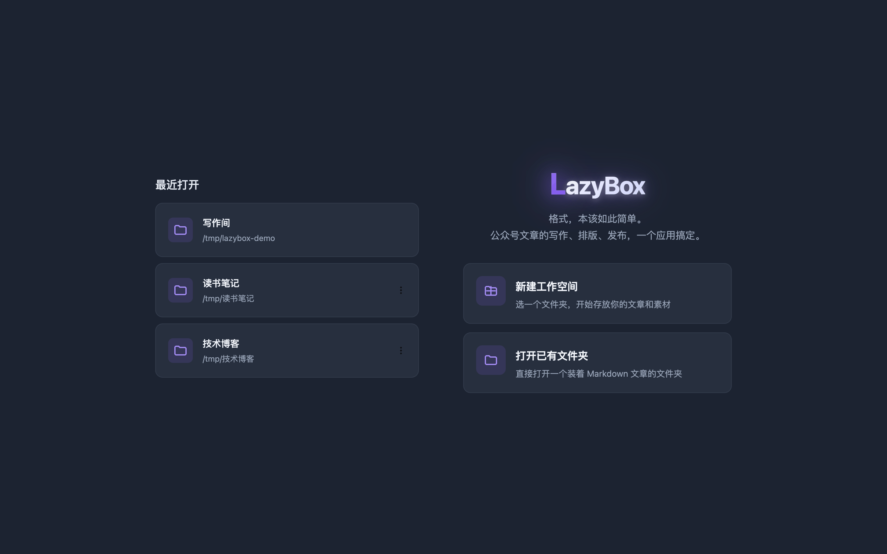

<div align="center">



<h3>给公众号作者的 Markdown 桌面编辑器</h3>

<p>本地写作 · 一键换主题 · 图片上传图床 · 复制到公众号后台直接粘贴</p>

[](https://github.com/melonlee/LazyBox/releases)
[](https://github.com/melonlee/LazyBox/actions/workflows/ci.yml)
[](https://github.com/melonlee/LazyBox/releases)
[](https://github.com/melonlee/LazyBox/stargazers)
[](./LICENSE)

**简体中文** · [English](./README.en.md) · [下载](https://github.com/melonlee/LazyBox/releases) · [使用指南](./docs/usage.md) · [更新日志](./CHANGELOG.md) · [路线图](./docs/ROADMAP.md)

</div>

---

## 为什么做 LazyBox

在公众号后台写长文，时间往往花在格式上：选中、改字号、改颜色，再选中下一段……换个风格，就得从头再调一遍。稿子还锁在后台草稿箱里，不好备份，也不好复用。

LazyBox 把这件事拆开：**你只管用 Markdown 写字，格式交给主题。** 文章是你硬盘上的 `.md` 文件，写完一键复制，到公众号后台粘贴即可。

<div align="center">
  
</div>

## 截图

<table>
  <tr>
    <td width="50%"><p align="center"><b>分屏写作</b>：左边 Markdown，右边就是公众号效果</p></td>
    <td width="50%"><p align="center"><b>一键换主题</b>：主题、字体、主题色、代码块样式</p></td>
  </tr>
  <tr>
    <td><p align="center"><b>发布</b>：复制到公众号，或导出带 Front Matter 的 .md</p></td>
    <td><p align="center"><b>图片上传</b>：GitHub、阿里云、腾讯云、七牛等图床</p></td>
  </tr>
  <tr>
    <td><p align="center"><b>AI 助手（可选）</b>：⌘K 润色、扩写、续写、翻译</p></td>
    <td><p align="center"><b>工作空间</b>：任意文件夹就是一个文章库</p></td>
  </tr>
</table>

<sub>以上均为应用内真实截图，文章为演示内容。</sub>

## 功能

**✍️ 写作**
- 打开任意文件夹作为工作空间，树形管理文章：新建、重命名、拖拽移动、搜索
- 编辑 / 分屏两种视图，自动保存
- 常用格式工具栏与快捷键，支持表格、代码高亮、Mermaid 流程图

**🎨 排版**
- 实时预览公众号效果
- 三套主题，可调字体、字号、主题色、代码块主题、图注样式
- 自定义 CSS，在默认主题基础上微调任何细节

**🖼️ 图片**
- 拖拽上传到 GitHub、阿里云 OSS、腾讯云 COS、七牛云、MinIO、Cloudflare R2、公众号图床，或自定义上传

**🚀 发布**
- 复制为公众号格式（样式已内联），到公众号后台直接粘贴
- 复制前检查本地 / base64 图片，避免粘贴后图片丢失
- 导出带 Front Matter 的 Markdown（适合 Hexo / Hugo / VitePress），或导出 HTML

**🤖 AI（可选，自带 API Key）**
- 支持 Claude，以及 DeepSeek、Kimi、通义千问、OpenAI 等 OpenAI 兼容接口
- 拟标题、写 120 字以内的公众号摘要、润色、扩写、续写、中英互译
- 请求从你的电脑直接发往你选择的服务商，LazyBox 不经手你的文章

> 知乎、掘金、语雀、飞书、Notion 的「一键发布」目前**暂不支持**；MCP、知识库、AI 生图等原型模块默认关闭，见[路线图](./docs/ROADMAP.md)。

## 下载

到 **[Releases 页面](https://github.com/melonlee/LazyBox/releases)** 下载最新版本。

| 系统 | 安装包 |
| --- | --- |
| macOS（Apple 芯片 / Intel） | `.dmg` |
| Windows | `-setup.exe` |
| Linux | `.AppImage` / `.deb` |

> 安装包暂未签名。macOS 若提示「已损坏」或「无法验证开发者」，请看[使用指南 · 安装](./docs/usage.md#安装)。

## 三步上手

1. 打开 LazyBox，**新建工作空间**或**打开已有文件夹**
2. 新建一篇文章，在分屏模式下写作，⌘, 打开设置挑一个主题
3. 点右上角 **发布 → 复制到公众号**，到 [公众号后台](https://mp.weixin.qq.com/) 粘贴

更多细节见 **[使用指南](./docs/usage.md)**。

## 常见问题

<details>
<summary><b>粘贴到公众号后图片不见了？</b></summary>

公众号无法读取本地图片。先用工具栏的「上传图片」把图片传到图床；通过「发布 → 复制到公众号」复制时，LazyBox 会提示哪些图片有问题。
</details>

<details>
<summary><b>能直接存进公众号草稿箱吗？</b></summary>

暂时不能。通过公众号官方接口（需要 AppID / AppSecret 和 IP 白名单）直接存草稿在路线图中。目前请复制后到后台粘贴。
</details>

<details>
<summary><b>必须用 AI 吗？会上传我的文章吗？</b></summary>

不必须，不配置 API Key 就不会发出任何 AI 请求。配置后，只有你主动触发的 AI 操作才会把相关文本发送给你选择的服务商。
</details>

<details>
<summary><b>和 doocs/md 有什么区别？</b></summary>

LazyBox 的排版能力来自 [doocs/md](https://github.com/doocs/md)。在此基础上，LazyBox 是一个桌面应用：文章以本地文件管理，增加了工作空间、文件树、发布检查与 AI 助手。如果你只需要在浏览器里偶尔排一篇，doocs/md 的在线版就很好用。
</details>

## 路线图

- [x] v0.2：真实可用的发布流程、AI 助手（Claude / OpenAI 兼容）、安全加固、多平台构建
- [ ] 公众号草稿箱直传（官方接口）
- [ ] 图片自动压缩、上传并替换正文中的本地图片
- [ ] 公众号手机宽度预览与长段落 / 大图提示
- [ ] macOS 签名公证与自动更新

完整内容见 [docs/ROADMAP.md](./docs/ROADMAP.md)。

## 本地开发

需要 Node.js 20+ 和 pnpm。

```bash
git clone https://github.com/melonlee/LazyBox.git
cd LazyBox
pnpm install
pnpm dev          # 启动开发模式
pnpm test         # 单元测试
pnpm build        # 构建到 out/
pnpm build:mac    # 打包安装包（另有 build:win / build:linux）
```

技术栈：Electron 28 · Vue 3 · Vite（electron-vite）· TypeScript · CodeMirror 5 · Pinia · Tailwind / UnoCSS。

```
src/
├── main/        主进程：窗口、文件系统、IPC、AI 服务、发布
├── preload/     预加载脚本，通过 contextBridge 暴露 window.$api
└── renderer/    Vue 应用：编辑器、预览、文件树、设置
```

发布新版本：更新 `package.json` 版本号和 `CHANGELOG.md`，推送 `v*` 标签，GitHub Actions 会构建 macOS / Windows / Linux 安装包并创建 Release 草稿。

## 贡献

欢迎 Issue 和 Pull Request。提交前请运行 `pnpm test` 与 `pnpm build`。想认领路线图里的功能，可以先开一个 Issue 讨论方案。

## 致谢

- [doocs/md](https://github.com/doocs/md)：Markdown 渲染与公众号排版能力
- [electron-vite](https://github.com/alex8088/electron-vite)
- 截图中的配图来自 [Unsplash](https://unsplash.com/)

## 许可证

[MIT](./LICENSE)

## Star History

<a href="https://www.star-history.com/#melonlee/LazyBox&Date">
 <picture>
   <source media="(prefers-color-scheme: dark)" srcset="https://api.star-history.com/svg?repos=melonlee/LazyBox&type=Date&theme=dark" />
   <source media="(prefers-color-scheme: light)" srcset="https://api.star-history.com/svg?repos=melonlee/LazyBox&type=Date" />
   
 </picture>
</a>

<div align="center">
  
  <br>
  <sub>Made by <a href="https://github.com/melonlee">@melonlee</a> · 格式，本该如此简单。</sub>
</div>
